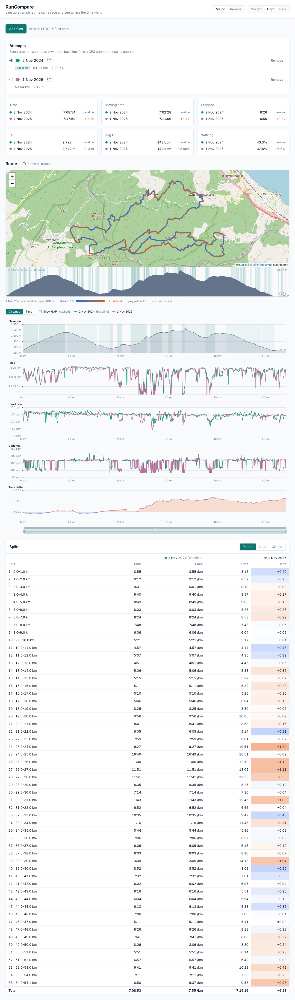

# RunCompare

RunCompare compares GPS attempts of the same race (FIT or GPX), plus pro or target split sets, by position on the course rather than by time. It lines every attempt up against one baseline, plots elevation, pace, grade-adjusted pace, heart rate, cadence and the running time delta on one shared axis, and explains where time was gained or lost. It's a static site: every file stays in your browser.



```sh
npm i && npm run dev
```

## Usage

1. **Add files.** Drop two or more FIT or GPX recordings of the same race or route on the page, or pick them with _Choose files_. Files that can't be read show a dismissible error; the rest still load.
2. **Pick the baseline.** The earliest of the first files you add becomes the baseline. Its track defines the course, and every other attempt is compared with it at the same course distance. Use the radio button in the attempts list to switch. Click a label to rename it, or the colour dot to recolour it. _Remove_ asks once more before it removes an attempt.
3. **Read the summary.** Each card shows every attempt's value and its difference from the baseline. Orange means behind, blue means ahead. Walking is marked _estimated_ when a file has no cadence.
4. **Explore the course.** The map colours the course by where the compared attempt gained or lost time, with the elevation profile docked underneath. The charts below share one zoom and one crosshair with each other and with the map. Drag the slider under the charts, or ctrl+scroll or pinch on a chart, to zoom. _Time_ relabels the axis with the baseline's elapsed time.
5. **Check the splits.** The table splits the course per km or mile, per baseline lap or per climb, with each attempt's time and its heat-coloured delta. Hover a row to highlight it on the map and charts, and click it to zoom there. The _Total_ row is the gap at the finish line. It can differ from the Time card, which counts time spent standing after the finish.
6. **Units and theme** are in the header and are remembered on this device.

See [`PLAN.md`](PLAN.md) for the design and [`tasks/`](tasks/README.md) for how the work is split up. MIT licensed.
