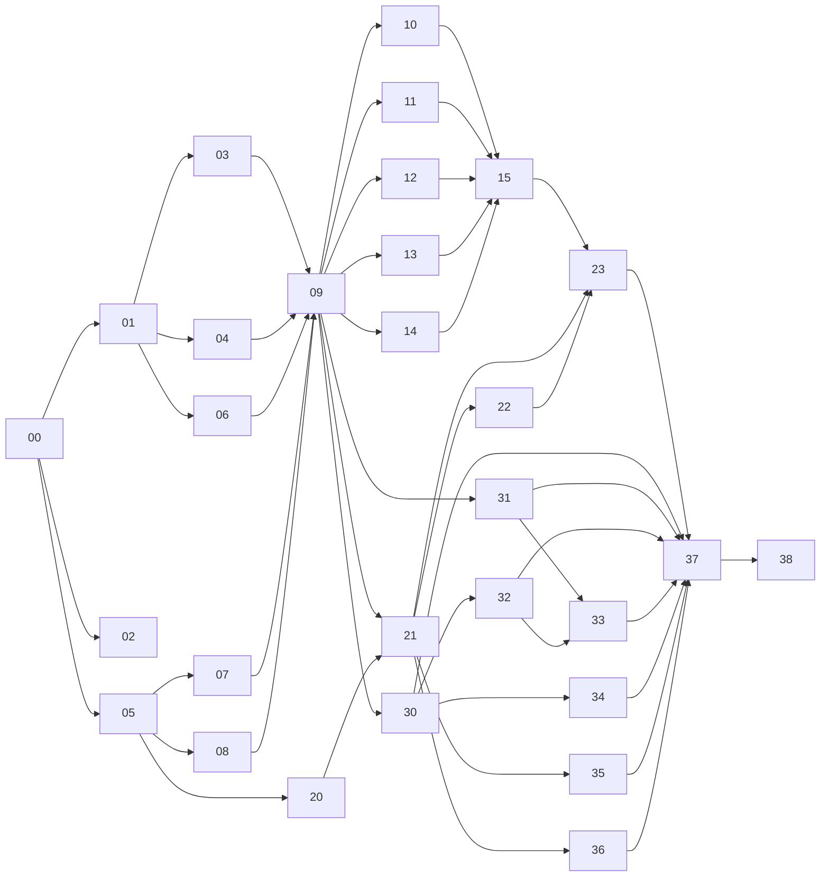

# Tasks

[`PLAN.md`](../PLAN.md) is broken down into small, independent tasks for builder agents. Each `NN-slug.md` file is a complete prompt: give an agent one file and it has everything it needs.

## Bootstrap (owner + Claude, once, before any task)

Run this from a shell whose SSH and `gh` both reach the **`vdassios`** account.

1. Verify the identity:
   - `gh auth status` shows `vdassios` as the active account.
   - `ssh -T git@github.com` replies "Hi vdassios!".
   - `va.dassios@gmail.com` is a verified email on that account, so commits link to the profile.
2. Set the repo-local identity: `git config user.name vdassios && git config user.email va.dassios@gmail.com`.
3. Confirm `git status` doesn't list `samples/`, which is gitignored. Raw files must never be committed.
4. Add `LICENSE` (MIT, "Copyright (c) 2026 vdassios") and `.claude/settings.json`. The settings deny `Bash(gh pr merge:*)`, `Bash(git push origin main:*)` and `Bash(git push -f:*)`. Agents run with the owner's credentials, so GitHub can't tell an agent's merge from the owner's. These deny rules are what keep merging in the owner's hands.
5. Make the initial commit: `.gitignore`, `PLAN.md`, `tasks/`, `LICENSE`, `.claude/settings.json`.
6. Create the repo and push: `gh repo create vdassios/runcompare --public --source . --push`.
7. Run task 00, then 01, 02 and 05 (see the graph below).
8. **After task 02 merges** (CI exists), turn on branch protection for `main`:
   - require a PR
   - require the status check `checks`, with the branch up to date
   - no force pushes, no deletions
   - no required approvals: a solo owner can't approve their own PRs

## Rules for every builder agent

Read these, then your task file, then `PLAN.md` (the sections your task cites), then `src/model/types.ts`.

1. **Stay inside your files.** Create or modify only the files listed under *You own*. If you need a change anywhere else, especially `src/model/types.ts`, stop and say so in the PR description. Don't make the change.
2. **Branch and PR.** Use the branch `task/NN-slug`, one PR titled `NN: <title>`, against `main`. Never push to `main` and never merge. The owner merges.
3. **Definition of done.** All of these pass locally, and the PR description says so:
   ```
   npm run lint && npm run typecheck && npm test
   ```
   plus every item under your task's *Acceptance* section.
4. **UI PRs** include a screenshot of each new or changed section, in light and dark mode.
5. **Dependencies.** Add only the runtime dependencies your task lists. Anything else must be justified in the PR. Pin exact versions.
6. **Conventions** (PLAN §3):
   - SI units internally; display only through `src/format/`.
   - Delta = attempt − baseline, positive means behind. Behind is orange, ahead is blue.
   - Analysis code is pure TypeScript with no DOM or React. Typed arrays; `NaN` for missing samples; `null` for missing streams.
   - No `any`.
   - Colours come from `src/theme/` tokens.
7. **Tests** sit next to the code (`foo.ts` → `foo.test.ts`). Fixture-based tests read from `fixtures/` only, never from `samples/`.
8. **When unsure,** write the open question in the PR description and choose the simplest option consistent with PLAN.md. Don't widen the scope.

## Task graph

| ID | Task | Milestone | Depends on |
|---|---|---|---|
| 00 | [Scaffold and shared contract](00-scaffold-contract.md) | M1 | — |
| 01 | [Fixture sanitizer](01-fixture-sanitizer.md) | M1 | 00 |
| 02 | [CI](02-ci.md) | M1 | 00 |
| 03 | [FIT parser](03-fit-parser.md) | M1 | 01 |
| 04 | [GPX parser](04-gpx-parser.md) | M1 | 01 |
| 05 | [Smoothing, grade, GAP](05-smoothing-gap.md) | M1 | 00 |
| 06 | [Course alignment](06-alignment.md) | M1 | 01 |
| 07 | [Grid resampling and delta](07-grid-resampling.md) | M1 | 05 |
| 08 | [Metrics and splits](08-metrics-splits.md) | M1 | 05 |
| 09 | [Pipeline, worker, store](09-pipeline-worker-store.md) | M1 | 03, 04, 06, 07, 08 |
| 10 | [App shell, upload, attempts list](10-shell-upload-attempts.md) | M1 | 09 |
| 11 | [KPI cards](11-kpi-cards.md) | M1 | 09 |
| 12 | [Linked charts](12-linked-charts.md) | M1 | 09 |
| 13 | [Route map](13-route-map.md) | M1 | 09 |
| 14 | [Splits table](14-splits-table.md) | M1 | 09 |
| 15 | [M1 end-to-end](15-m1-e2e.md) | M1 | 09–14 |
| 20 | [Split-set model](20-split-set-model.md) | M2 | 05 |
| 21 | [Pipeline: split sets and distance baselines](21-pipeline-split-sets.md) | M2 | 09, 20 |
| 22 | [Split-set editor and baseline picker](22-split-set-editor.md) | M2 | 20, 21 |
| 23 | [M2 end-to-end](23-m2-e2e.md) | M2 | 15, 21, 22 |
| 30 | [Climb and descent detection](30-climbs.md) | M3 | 09 |
| 31 | [Insight rules A: effort and fade](31-insights-effort.md) | M3 | 09 |
| 32 | [Insight rules B: comparison](32-insights-comparison.md) | M3 | 09, 30 |
| 33 | [Insights panel](33-insights-panel.md) | M3 | 31, 32 |
| 34 | [Climbs table](34-climbs-table.md) | M3 | 30 |
| 35 | [Lap-snapping](35-lap-snapping.md) | M3 | 21 |
| 36 | [Session persistence](36-persistence.md) | M3 | 21 |
| 37 | [M3 end-to-end](37-m3-e2e.md) | M3 | 23, 30–36 |
| 38 | [Deploy to Cloudflare Pages](38-deploy.md) | Deploy | 37 |



**Suggested waves.** Inside a wave, tasks can run in parallel. Finish a milestone before starting the next unless you have spare agents.
- **Wave 1:** 00
- **Wave 2:** 01, 02, 05
- **Wave 3:** 03, 04, 06, 07, 08, 20
- **Wave 4:** 09
- **Wave 5:** 10, 11, 12, 13, 14, 21, 30, 31
- **Wave 6:** 15, 22, 32, 34, 35, 36
- **Wave 7:** 23, 33
- **Wave 8:** 37, then 38
